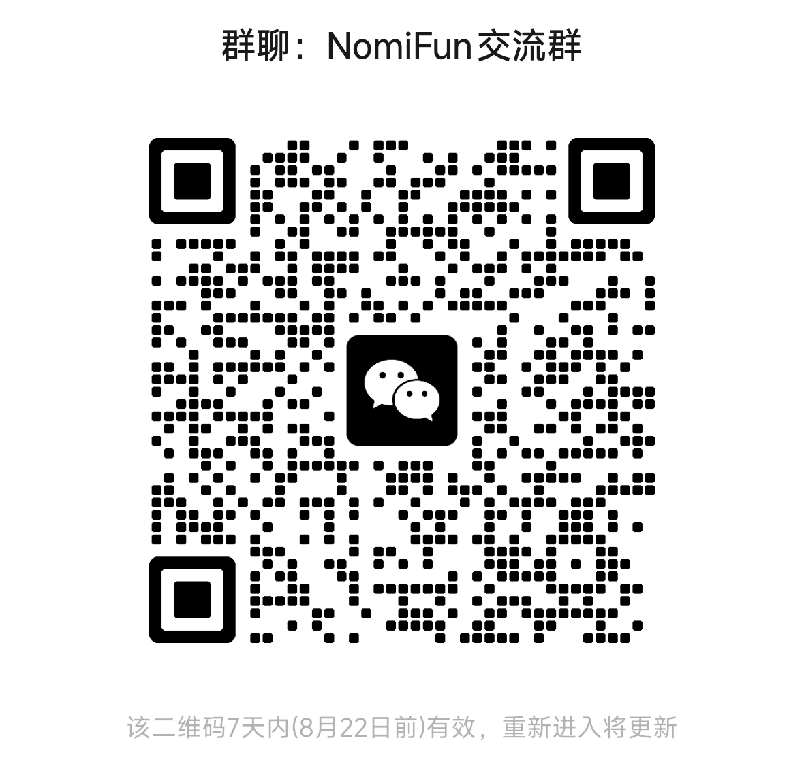

# NomiRelay

(English | [中文](README.md))

Source repository: [GitHub](https://github.com/nomifun/nomifun-net-infra) ·
[Gitee (China mirror)](https://gitee.com/nomifun/nomifun-net-infra)

**NomiRelay** is a general-purpose, self-hosted network relay. It exposes HTTP,
WebSocket, TCP, and UDP services behind home or factory NAT to phones and IoT
devices through infrastructure controlled by the operator.

It combines the reverse-proxy shape of
[frp](https://github.com/fatedier/frp) with a relay-oriented trust model while
making authentication, transport degradation, target policy, and operational
limits explicit.

- [Integration documentation](docs/integration/README.md) describes the current
  behavior, API, wire protocol, capability matrix, and known gaps.
- [Design specification](docs/superpowers/specs/2026-08-07-nomirelay-design.md)
  records the intended architecture.
- [Research archive](docs/research/) contains the source-level inputs behind the
  design decisions.

## The NomiFun open-source family

NomiRelay is the core service in
NomiFun Net Infra ([GitHub](https://github.com/nomifun/nomifun-net-infra) · [Gitee](https://gitee.com/nomifun/nomifun-net-infra)), the network
infrastructure layer in a family of four related open-source projects.

| Project | Responsibility | Product and documentation |
|---|---|---|
| NomiFun Desktop ([GitHub](https://github.com/nomifun/nomifun-desktop) · [Gitee](https://gitee.com/nomifun/nomifun-desktop)) | Local source of truth and execution hub for data, models, Agents, companions, tasks, and tools | [Product page](https://www.nomifun.com/products/desktop/) · [Docs](https://www.nomifun.com/docs/) |
| NomiFun Mobile ([GitHub](https://github.com/nomifun/nomifun-mobile) · [Gitee](https://gitee.com/nomifun/nomifun-mobile)) | Android, iOS, and H5 client that uses Desktop over HTTP/WebSocket | [Product page](https://www.nomifun.com/products/mobile/) · [Relay integration](https://github.com/nomifun/nomifun-mobile/blob/main/docs/RELAY-INTEGRATION.md) |
| NomiFun Xiaozhi Yuntai ([GitHub](https://github.com/nomifun/nomifun-xiaozhi-yuntai) · [Gitee](https://gitee.com/nomifun/nomifun-xiaozhi-yuntai)) | ESP32-S3 hardware surface that connects voice, display, motion, and device MCP tools to Desktop companions | [Product page](https://www.nomifun.com/products/xiaozhi-yuntai/) · [Integration guide](https://www.nomifun.com/docs/guides/xiaozhi-robot/) |
| **NomiFun Net Infra** (this repository; [GitHub](https://github.com/nomifun/nomifun-net-infra) · [Gitee](https://gitee.com/nomifun/nomifun-net-infra)) | Self-hosted relay for reaching Desktop and other services behind NAT from phones and IoT devices across networks | [Product page](https://www.nomifun.com/products/net-infra/) · [Portal guide](https://www.nomifun.com/docs/guides/net-infra/) · [Repository docs](docs/integration/) |

On a trusted LAN, Mobile should still connect directly to Desktop. Across
networks, an operator can deploy `nfrelay`, run `nfagent` where it can reach
Desktop, and point Mobile at the relay **business endpoint**. Mobile must not
hold the relay admin password, enrol token, or console API privileges. Desktop
remains the application data and execution hub; NomiRelay transports traffic
and enforces network policy.

## Target scenarios

| Scenario | Shape |
|---|---|
| Service access | Public phone → relay → Desktop or another service behind NAT, over HTTP/WebSocket/TCP/UDP |
| Reverse proxy | A factory robot configured with only relay IP + port → a designated remote Desktop, with no client software on the device |

## Quick start

```bash
make ui && make build
./bin/nfrelay -data-dir ./data
```

Open the printed console URL and complete first-run initialization. Issue a
one-time enrol token, then run the generated command on the machine that can
reach the target service:

```bash
nfagent -relay relay.example.com:8443 \
  -pin '<SPKI pin>' \
  -token '<one-time enrol token>' \
  -state-dir /var/lib/nfagent
```

Create a tunnel in the console and connect clients to that tunnel's business
endpoint. The relay console port is an operator surface, not a Mobile endpoint.

Default ports are `8443/udp` for the agent carrier, `9443/tcp` for the console
(loopback by default), and one business entry port per exposed tunnel.

## Core capabilities

- QUIC/UDP first, with TLS/TCP + smux fallback when UDP is blocked;
- HTTP, WebSocket, TCP, and UDP tunnels with shared-ingress options;
- SPKI pinning, HMAC authentication with TLS exporter binding, one-time agent
  enrolment, and replay protection;
- default-deny local-target policy with cloud-metadata blocking and DNS
  rebinding checks;
- per-tunnel connection, source, bandwidth, and packet-rate limits;
- embedded React console, SQLite persistence, audit events, and metrics;
- optional TURN/STUN, shared ingress, ACME, Docker Compose, and systemd paths.

Transport degradation is reported explicitly: UDP tunnels are not silently
carried over the reliable L2 fallback. See the
[capability matrix](docs/integration/05-capabilities.md) and
[known gaps](docs/integration/09-known-gaps.md) before production deployment.

## Security and deployment boundaries

- The console is plain HTTP and binds to loopback by default. Keep it local,
  use an SSH tunnel, or place it behind an explicitly configured TLS proxy.
- `nfagent` pins the relay SPKI key. There is no skip-verification switch.
- A successful loopback test is not proof of a safe public deployment. Validate
  HTTPS/WSS, certificates, firewall rules, DNS, persistence, backups, and
  revocation separately.
- Enrol tokens are one-time bootstrap credentials. Store the agent state in a
  persistent directory so restarts reuse the issued long-term credential.

## Development

```bash
make check       # complete validation for cross-cutting changes and releases
make e2e         # real relay + agent + backend on loopback
make ui          # build the embedded web console
make web-check   # frontend type and lint checks
make dist        # cross-compile release artifacts and checksums
```

Match validation to the change: documentation-only edits do not need a build;
targeted changes should use targeted checks before the full suite.

## Community

- Website and bilingual product docs: [https://www.nomifun.com](https://www.nomifun.com)
- Issues: [nomifun-net-infra Issues](https://github.com/nomifun/nomifun-net-infra/issues)
- Email: [535526063@qq.com](mailto:535526063@qq.com)
- WeChat group: scan the QR code below. The image may be refreshed as group
  codes expire; use the latest repository copy.



## License

MIT. See [LICENSE](LICENSE). Copyright RiKa0-0 & NomiFun.
